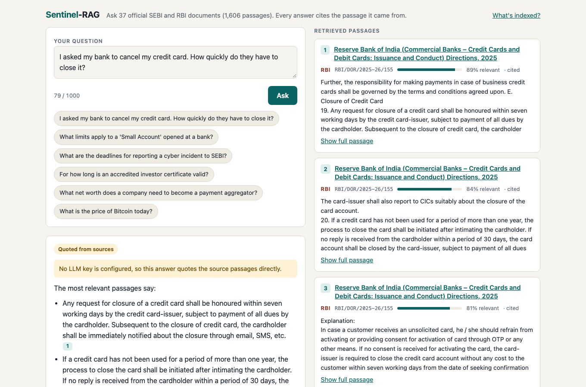
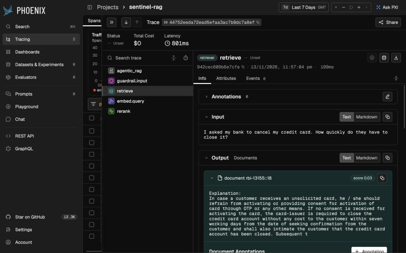

# Sentinel-RAG

Ask questions about Indian securities and banking regulation and get an answer
that cites the exact passage it came from, with a link to the regulator's own
page. It runs over 37 official SEBI and RBI documents (1,606 passages).



It is built the way a production RAG service is built, at a size one person can
read in an afternoon:

- **Hybrid retrieval**: BM25 and dense vectors, fused with Reciprocal Rank Fusion.
- **Cross-encoder reranking**, on ONNX Runtime, so it runs on a small CPU box with no torch.
- **An agent loop that makes decisions**: rewrite and retry when retrieval is weak, refuse when nothing relevant is found, and fall back to quoting passages when the LLM is unavailable.
- **Guardrails**: input limits, prompt-injection flagging, a calibrated relevance gate, PII redaction.
- **An evaluation harness** with a golden set, a retrieval ablation and threshold calibration. The numbers below come from it.
- **Tracing** with OpenTelemetry, using OpenInference attribute names so Phoenix renders each question as a trace tree.
- **A hardened public API**: rate limits, no write endpoints unless an admin token is set, clean error responses.
- **Free to run**: Groq and Gemini free tiers for generation, local models for everything else.

## Results

All numbers are from `data/golden/qa.jsonl`: 50 answerable questions, each tied
to a verbatim quote in the source text, plus 12 out-of-scope questions. A
retrieved passage counts as a hit only if it contains that quote.

### Retrieval ablation (50 answerable questions)

| Configuration | Hit@1 | Hit@5 | MRR | Mean latency |
|---|---|---|---|---|
| BM25 only | 0.58 | 0.92 | 0.71 | 3 ms |
| Dense only | 0.62 | 0.86 | 0.72 | 9 ms |
| Hybrid (RRF) | 0.62 | 0.82 | 0.70 | 14 ms |
| BM25 + rerank | 0.86 | 0.96 | 0.90 | 289 ms |
| Dense + rerank | 0.82 | 0.92 | 0.86 | 302 ms |
| **Hybrid + rerank** | **0.90** | **1.00** | **0.94** | 310 ms |

Hit@1 by the kind of question:

| Configuration | Plain questions (33) | Paraphrased (11) | Reference-number lookups (6) |
|---|---|---|---|
| BM25 only | 0.58 | 0.36 | 1.00 |
| Dense only | 0.70 | 0.64 | 0.17 |
| Hybrid + rerank | 0.88 | 0.91 | 1.00 |

What this shows:

- **The reranker does most of the work.** Fusion on its own did not beat the
  better single retriever on this set.
- **Hybrid still earns its place**, as the candidate generator. Dense search
  cannot find a document by its reference number (`RBI/DOR/2025-26/155`), and
  BM25 is weak on paraphrased questions. Only the combination is strong on
  both, which is what lets the reranker reach 100% in the top five.

### Refusals and end-to-end

| | |
|---|---|
| Refusal decisions correct | 62 of 62 at the calibrated threshold |
| Answers carrying a citation | 50 of 50 |
| Latency, native (8 cores) | 0.30 s mean, 0.36 s p95 |
| Latency, container limited to 2 CPUs | 1.05 s mean, 1.24 s p95 |

Read these with the right caveats:

- The set is small and I wrote it, from passages I had read. It measures
  whether the system finds what is there, not how it does on questions real
  users would invent.
- The refusal threshold is fitted to this set. The lowest-scoring answerable
  question (0.42) and the highest-scoring out-of-scope one (0.36) are close, so
  a larger set would very likely show some errors.
- The end-to-end run used extractive mode (no LLM key on the build machine).
  **Generated answers have not been evaluated.** The harness supports it
  (`--mode full` with a key adds an LLM-judged faithfulness score), and that is
  the first thing to run after adding a key.

Reports are in `data/eval/`. Reproduce with `make eval` and `make calibrate`.

## How it works

```
 Official pages (SEBI PDFs, RBI HTML)
        │  scripts/fetch_circulars.py
        ▼
 loader ──► clause-aware chunker ──► embeddings ──► vector store (files or pgvector)
                                                        │
                                                        └──► BM25 (rebuilt in memory)

 POST /query
        │
        ▼
 ┌──────────────────────────── agent loop ────────────────────────────┐
 │ 1. input guardrail      length, whitespace, injection flag         │
 │ 2. hybrid retrieve      BM25 + dense ──► RRF                       │
 │ 3. rerank               cross-encoder, scores squashed to 0..1     │
 │ 4. grounded?  ── no ──► rewrite the query, retrieve once more      │
 │ 5. still no   ────────► refuse (and show the closest passages)     │
 │ 6. generate             cited answer from the configured LLM       │
 │    LLM unavailable ───► quote the best passages instead            │
 │ 7. output guardrail     redact Aadhaar / PAN shaped identifiers    │
 └────────────────────────────────────────────────────────────────────┘
        │
        ▼
 answer, mode, citations, source passages with relevance, timings, trace id
```

| Module (`src/ragsys/`) | Responsibility |
|---|---|
| `config.py` | One typed settings object. Every provider and limit is switched here. |
| `ingest/` | `loader` (PDF, HTML, text; reference numbers and dates), `chunker`, `pipeline`. |
| `store/` | `vector_store` (file-backed numpy, or pgvector), `bm25_store`. |
| `llm/` | `provider` (Groq, Gemini, OpenAI, Anthropic), `embeddings`. |
| `retrieval/` | `hybrid` (RRF fusion), `rerank` (cross-encoder). |
| `generation/` | `guardrails`, `generator` (cited answers, extractive fallback, query rewrite). |
| `agent/` | `orchestrator`: the decision loop. |
| `eval/` | `metrics`, `run_eval` (ablation and end-to-end), `calibrate`. |
| `api/` | FastAPI app, rate limiting and admin auth, the chat UI. |
| `telemetry.py`, `runtime.py` | Tracing; CPU detection inside containers. |

## Quickstart

### 1. Run it with no keys

```bash
python -m venv .venv && source .venv/bin/activate
make install
make serve            # http://localhost:8000
```

The index ships in `data/index/`, so this works immediately. Without an LLM key
the app answers by quoting the most relevant passages. The first start
downloads about 90 MB of model weights.

```bash
make test             # 103 offline tests, no network or keys
make smoke            # real local models over a tiny sample corpus
```

### 2. Add a free LLM for generated answers

```bash
cp .env.example .env
# set LLM_PROVIDER=groq and GROQ_API_KEY=...   (or gemini + GEMINI_API_KEY)
make serve
```

```bash
curl -s localhost:8000/query -H 'content-type: application/json' \
  -d '{"question": "How quickly must a bank close a credit card after a closure request?"}'
```

### 3. Full stack: Postgres, pgvector and tracing

```bash
docker compose up --build -d
```

- Chat UI: http://localhost:8000
- Traces: http://localhost:6006

This runs the same image against Postgres with pgvector (seeded automatically
from the shipped index on first start) and sends traces to Phoenix.



## The corpus

`data/sources.json` lists every document with the regulator's own URL: 12 RBI
directions (KYC, cards, deposits, outsourcing, fraud, digital payments, payment
aggregators, prepaid instruments and others) and the 25 most recent SEBI
circulars at the time of fetching.

```bash
make fetch            # downloads the originals to data/raw (not committed)
make ingest           # rebuilds data/index
```

SEBI pages embed a PDF; RBI pages carry the full text as HTML. The loader
handles both, strips page furniture and the Hindi half of bilingual circulars,
rejoins lines a PDF wrapped mid-sentence, and reads the reference number and
date from the top of each document.

To use your own documents, put PDFs, HTML or text files in a folder and run
`python scripts/ingest_cli.py --path your/folder`.

## Design notes

**Why rank fusion.** BM25 scores are unbounded and cosine similarity is not, so
they cannot be added. RRF fuses on rank: `score(d) = Σ 1 / (k + rank_r(d))`,
with `k = 60`.

**Passages carry their title.** Every chunk is embedded, indexed and reranked
as `title + text`, so a clause still says which regulation it belongs to once
it is cut out of the document.

**One relevance scale.** Cross-encoders emit raw logits whose range depends on
the model. They are passed through a sigmoid, so the grounding threshold means
the same thing whichever reranker is configured. A passage that only BM25 found
has no relevance score at all: a keyword match is not evidence that the passage
answers the question.

**Choosing the threshold.** `make calibrate` records the top relevance score
for every golden question and sweeps the threshold. The default, 0.4, is the
value that separates the two groups on this set.

**Degrade, don't fail.** Free LLM tiers rate-limit hard. A missing key, a 429
or a timeout turns into an extractive answer with a notice saying why. The demo
keeps working when the quota runs out.

**Sized for a small container.** Two findings from running the image under a
2-CPU limit:

- ONNX Runtime sizes its thread pool from the host's core count, not the
  container's quota, which made each question take about nine seconds.
  `runtime.available_cpus()` reads the cgroup quota instead.
- The int8 build of the reranker was about twice as fast as full precision and
  scored the same or better on the golden set, so it is the default.

**One source of truth for text.** The vector store holds the chunks. The BM25
index is rebuilt from it in memory at startup and after every ingest, so the
two can never disagree.

## API

| Endpoint | |
|---|---|
| `GET /` | The chat UI. `/?q=your+question` opens with that question asked. |
| `POST /query` | `{"question": "..."}` → answer, mode, citations, sources, timings. Rate limited. |
| `GET /health` | Index size and the active configuration. |
| `GET /meta` | The document list and example questions. |
| `POST /ingest/sample`, `POST /ingest/path` | Exist only when `ADMIN_TOKEN` is set, and require it as a bearer token. `path` must be inside `data/`. |

The `mode` field tells the client what kind of answer it got: `generated`,
`extractive` or `refused`.

## Evaluation

```bash
make eval                                             # retrieval ablation, no LLM needed
python -m ragsys.eval.run_eval --mode full            # whole agent, uses the LLM if configured
python -m ragsys.eval.run_eval --mode full --pause 15 # stay under free-tier rate limits
make calibrate                                        # threshold sweep
```

| Metric | Meaning |
|---|---|
| `hit@k`, `mrr` | Rank of the first retrieved passage containing the evidence quote. |
| `refusal_accuracy`, `wrongly_refused`, `wrongly_answered` | Did the system refuse exactly the out-of-scope questions. |
| `citation_rate` | Share of answers that cite a source. |
| `keyword_recall` | Share of the reference answer's content words present in the answer. |
| `faithfulness_llm_judged` | An LLM judges whether every claim is supported by the passages. Needs a key. |

`--ragas` adds RAGAS faithfulness and context recall
(`pip install -r requirements-eval.txt`). That path follows the RAGAS
documentation but has not been run here, because it needs an LLM key.

A test checks that every evidence quote in the golden set still exists in the
index, so the eval cannot silently rot when the corpus is rebuilt.

## Configuration

Everything is an environment variable. `.env.example` lists the common ones and
`src/ragsys/config.py` is the full list. The ones that matter most:

| Variable | Default | |
|---|---|---|
| `LLM_PROVIDER` | `groq` | `groq`, `gemini`, `openai`, `anthropic` or `none`. |
| `VECTOR_BACKEND` | `memory` | `memory` (files in `data/index`) or `pgvector`. |
| `DATABASE_URL` | unset | Postgres URL for pgvector, for example a hosted free tier. |
| `MIN_CONTEXT_SCORE` | `0.4` | The relevance gate. |
| `RATE_LIMIT_PER_MINUTE` | `8` | Per visitor. Also `RATE_LIMIT_PER_DAY`, `GLOBAL_DAILY_LIMIT`. |
| `ADMIN_TOKEN` | unset | Enables the ingest endpoints. |
| `TRACING_ENABLED` | `false` | Send spans to `OTEL_EXPORTER_OTLP_ENDPOINT`. |

## Deployment

See [docs/DEPLOY.md](docs/DEPLOY.md). In short: the image needs 1 vCPU and 1 GB
of RAM. Google Cloud Run's free allowance covers it (card on file required),
and `deploy/streamlit/app.py` runs the same pipeline on Streamlit Community
Cloud with no card. Hugging Face Docker Spaces now need a paid plan.

## Known limits

- **Generation is untested against a live provider.** The Groq, Gemini and
  Anthropic code paths are covered by tests that fake the HTTP layer (request
  shape, error handling), not by real calls.
- **Single-turn.** Each question is answered on its own; there is no
  conversation memory.
- **One process.** The rate limiter and the BM25 index live in memory, which is
  correct for one worker and wrong for several.
- **The corpus is a snapshot.** 37 documents fetched on 13 November 2026.
  Regulations change; there is no scheduled refresh.
- **Tables are flattened.** Tabular content in the source documents becomes
  running text, so questions that depend on a table's layout do less well.
- **The LangSmith tracing route is untested**; Phoenix is the one that was run.

## License and disclaimer

Code: MIT, see [LICENSE](LICENSE).

The text in `data/index/` is extracted from documents published by SEBI and the
RBI and remains theirs; it is included so the demo can cite it, with a link to
each original.

This is an educational project. It is not legal or compliance advice. Always
check the official SEBI and RBI documents.
